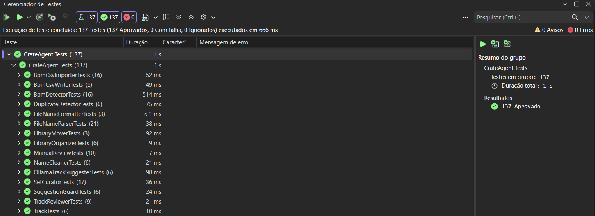

# 🎧 CrateAgent

[](https://github.com/AlessandraBatistaJ/crate-agent/actions/workflows/ci.yml)

Organizador de bibliotecas de música, feito em C# / .NET 8.
O projeto nasceu de um problema real: uma pasta de downloads do Bandcamp e de outras fontes, cheia de arquivos sem tags, com nomes sujos e códigos de selo misturados com o título.

> 🚧 **Em construção.** Organização, revisão, duplicatas, curador de sets e um detector de BPM estão prontos e testados. O detector **ainda erra em parte das faixas** (veja abaixo), e um experimento com IA local (Ollama) existe, mas só **sugere**. O tom (Camelot) ainda vem de um CSV.



## O que já funciona

- ✅ **Scanner** que lê as tags dos arquivos de áudio (TagLibSharp)
- ✅ **Fallback pelo nome do arquivo** quando as tags estão vazias (hífen, meia-risca e travessão como separadores)
- ✅ **Limpeza de nomes**: remove a palavra "Premiere", posição de vinil (`A1`), código de lançamento (`MR021`) e o canal que aparece antes de "Premiere"
- ✅ **Revisão automática**: artista ausente, título suspeito ou prefixo descartado vão para a pasta `_Revisar`
- ✅ **Revisão manual** no console: aprovar, corrigir (`Artista - Título`) ou pular cada faixa
- ✅ **Detecção de duplicatas** por hash do conteúdo (SHA-256). A cópia vai para `_Duplicadas`; nada é apagado
- ✅ **Dry-run**: mostra para onde cada arquivo iria, sem mover nada
- ✅ **Mover de verdade** com log em JSON e **desfazer** pelo log
- ✅ **Importação de BPM e tom** (notação Camelot) por CSV, com validação
- ✅ **Curador de sets** por BPM crescente e compatibilidade na roda Camelot
- ✅ **Detector de BPM por código**, que salva o resultado em CSV (a origem do número fica na coluna `obs`) e mostra os melhores candidatos de cada faixa para diagnóstico
- ✅ **Avaliador de gabarito**: compara o resultado do programa com nomes escritos à mão
- ✅ **CI** no GitHub Actions e **137 testes automatizados** com xUnit

## Como funciona

```
Pasta de músicas ─► Scanner ─► Limpeza ─► Revisão ─► Duplicatas ─► Plano (dry-run) ─► Mover (com log)
                                                                                           │
                                                                           Desfazer ◄──────┘

MP3 ─► Decodificador ─► Detector de BPM ─► CSV (bpm; origem) ─► Curador de sets
```

Faixas com dados confiáveis vão para `Artista Nome/Artista_Nome - Título_Nome.mp3`.
Faixas duvidosas vão para `_Revisar`, **mantendo o nome original**.

Exemplo real (46 faixas de uma pasta de teste). Depois da revisão manual de 7 faixas, o resultado foi 41 organizadas, 4 em revisão e 1 duplicata:

| Arquivo original | Destino |
|---|---|
| `MR036_Digital_Bonus_01_Human_Safari_-_Dorian.mp3` | `Human Safari/Human_Safari - Dorian.mp3` |
| `Premiere_Bailey_Ibbs_JKS_-_Rituals_SMILE006.mp3` | `Bailey Ibbs JKS/Bailey_Ibbs_JKS - Rituals_SMILE006.mp3` |
| `Night_Train.mp3` | `_Revisar/Night_Train.mp3` |
| `Isaiah_-_When_You_Touch_Me_..._Remix (1).mp3` | `_Duplicadas/...` |

## Menu

```
1 = Organizar | 2 = Desfazer | 3 = Avaliar gabarito | 4 = Importar BPM | 5 = Montar set
6 = Detectar BPM (medir) | 7 = Detectar BPM (salvar em CSV) | 8 = Diagnosticar BPM
```

## Decisões de projeto

- **O código só move o que tem certeza.** O resto vai para revisão, e quem decide é uma pessoa.
- **Ausência de informação não é um dado falso.** Por isso o BPM é `int?`, e não `int` com valor 0.
- **Nunca sobrescreve e nunca apaga arquivos.** Se o destino já existe, a faixa é ignorada. Duplicatas vão para uma pasta, e quem decide é você.
- **Tudo é reversível.** Cada movimentação é registrada em um log que permite desfazer.
- **Código de catálogo no título é mantido** (`Rituals_SMILE006`), porque carrega informação sobre o lançamento.
- **Prefixo descartado pede conferência.** Quando o programa remove o que vinha antes de "Premiere" (supondo que seja o canal), a faixa vai para revisão.
- **Dado ruim não vira dado falso.** O importador de BPM só aceita tons de `1A` a `12B`; qualquer outra coisa vira "sem informação".
- **Valor manual vale mais que valor detectado.** O CSV guarda a origem de cada BPM (`detectado`, `rekordbox`), e valores corrigidos à mão nunca são sobrescritos.
- **Medir antes de decidir.** Os critérios de aprovação dos experimentos foram definidos antes de rodá-los.

## Medindo em vez de achar

Para saber se as regras funcionam, escrevi um **gabarito**: o nome final esperado de 45 arquivos de teste. O avaliador (opção 3) compara o programa com ele.

| Versão | Acertos |
|---|---|
| Parser inicial | 32/45 (71%) |
| Com regras para canal, vinil e código no início do artista | 44/45 (98%) |

⚠️ **Ressalva importante:** as regras foram escritas olhando essas mesmas 45 faixas, então os 98% são otimistas. A prova justa exige uma pasta nova, com arquivos que o código nunca viu.

## IA local: o que eu medi

Testei o `llama3.2` (rodando local, via Ollama) para sugerir artista e título:

- Em 5 faixas com nomes sujos, acertou 1. O modelo ignorou o separador ` - ` e quebrou nomes no meio.
- Em 4 faixas **sem artista**, acertou 2, **inventou um artista** (`Ariana Grande`, sem nenhuma base no nome do arquivo) e repetiu o título como artista em outra.

Por isso a IA **só sugere**, e uma camada de regras (`SuggestionGuard`) rejeita sugestões com palavras que não estão no nome do arquivo, artista igual ao título ou título com separador. Nesses 4 casos, o guarda barrou as 2 sugestões erradas.
Conclusão atual: para extrair artista e título do nome do arquivo, regras funcionam melhor que um modelo pequeno. A IA fica reservada para tarefas em que regra não alcança, como interpretar pedidos de set em linguagem natural.

## Curador de sets (versão inicial, sem IA)

Dado um BPM inicial, um BPM final e um número máximo de faixas, o curador:

1. considera só faixas com BPM dentro da faixa pedida, ordenadas do menor para o maior;
2. aceita a próxima faixa só se o BPM não cair e o salto for de no máximo 4 BPM;
3. entre as candidatas, prefere **tom compatível** na roda Camelot (mesmo tom, ±1 na mesma letra, ou a outra letra no mesmo número);
4. para quando não houver faixa dentro do salto, em vez de forçar uma transição ruim.

**Limitação:** ele só ordena do mais baixo para o mais alto, e não tem um destino. Pedindo 120 a 150 BPM com 15 faixas, o set foi de 132 a 142.
Testado com faixas de BPM medido (à mão e por código). **Isso mostra que o código segue as regras, não que o set soa bem**; essa avaliação é feita ouvindo.

## Detecção de BPM

O BPM pode ser detectado por código: um filtro deixa só os graves (onde o bumbo mora), o programa mede os picos de energia e testa cada BPM de 90 a 180 para ver qual encaixa melhor nos picos. A janela de 90 a 180 é uma suposição: uma faixa de 70 BPM real sai como 140.

**Medições com referência externa**, sem ajuste do algoritmo entre elas:

| Medição | Referência | Faixas | Dentro de ±1 BPM |
|---|---|---|---|
| 1 | Site de análise | 10 (137–146 BPM) | 9/10 |
| 2 | Rekordbox | 10 (128–145 BPM), pasta que o código nunca tinha visto | 10/10 |

**Em escala (35 faixas, sem referência):** 31 saíram entre 131 e 149 BPM e 4 fora dessa faixa. As 4 foram conferidas no Rekordbox, e **3 estavam erradas**:

| Faixa | Detector | Rekordbox |
|---|---|---|
| Cirkle - Silent Rage | 92,7 | 139 |
| Bailey Ibbs JKS - Rituals | 96,8 | 145 |
| Side To Side | 162,2 | 153 |
| GIO - I Wanna Dance | 151,9 | 152 (certa) |

Nas duas primeiras, o detector achou exatamente **2/3 do andamento real** (92,7 × 1,5 ≈ 139; 96,8 × 1,5 ≈ 145). Na terceira, a causa é desconhecida.

⚠️ **Ressalvas:** as 4 foram escolhidas por parecerem estranhas, então isso **não é uma taxa de erro**; as outras 31 não foram conferidas. O que se sabe é que **ao menos 3 das 35 (cerca de 9%) estão erradas**. As faixas testadas são todas de música eletrônica com bumbo marcado, e as referências são outras ferramentas de detecção. O algoritmo ainda não foi corrigido: o próximo passo é diagnosticar (opção 8) e validar em faixas independentes antes de mudar qualquer coisa.

## Limitações conhecidas

- A regra que trata o texto antes de "Premiere" como canal também remove artistas legítimos nessa posição. Exemplo real: em `SIAH Premiere bmod`, o `SIAH` faz parte do nome. Por isso essas faixas vão para revisão, e a pessoa corrige.
- Duplicatas só são detectadas quando os arquivos são **idênticos byte a byte**. A mesma música em dois formatos ou bitrates não é reconhecida.
- O `Program.cs` (a interface de console) não tem testes automatizados. Um bug real passou despercebido por isso: um trecho foi perdido ao colar código e as duplicatas deixaram de ser tratadas, e só uma execução manual mostrou.
- A leitura de MP3 (`Mp3Decoder`) também não tem teste automatizado, e a detecção de BPM só funciona com MP3.
- **O BPM detectado pode estar errado sem nenhum aviso** (veja acima), e o curador o usa como se estivesse certo. Os valores errados conhecidos foram corrigidos à mão no CSV.
- Os CSVs de BPM são indexados pelo **nome do arquivo**. Dois arquivos com o mesmo nome em pastas diferentes colidem.
- O **tom (Camelot) ainda vem de um CSV** preenchido à mão. Sem ele, todo set mostra "tom desconhecido".
- As decisões da revisão manual **não são salvas** entre execuções. Persistência com SQLite está no roadmap.
- O curador usa só BPM e tom: não considera energia, gênero nem duração em minutos.
- O avaliador de nomes usa arquivos que também serviram para criar as regras (veja a ressalva acima).

## Stack

C# · .NET 8 · xUnit · TagLibSharp · NLayer · System.Text.Json · GitHub Actions · Ollama (experimental)

## Estrutura

```
CrateAgent.Core    → modelos e serviços (a lógica)
CrateAgent.Cli     → interface de console
CrateAgent.Tests   → testes automatizados
```

Principais serviços: `LibraryScanner`, `FileNameParser`, `NameCleaner`, `TrackReviewer`, `ManualReview`, `DuplicateDetector`, `LibraryOrganizer`, `LibraryMover`, `FileNameFormatter`, `BpmCsvImporter`, `BpmCsvWriter`, `SetCurator`, `BpmDetector`, `Mp3Decoder`, `OllamaTrackSuggester`, `SuggestionGuard` e `GabaritoEvaluator`.

## Como rodar

```bash
git clone https://github.com/AlessandraBatistaJ/crate-agent.git
cd crate-agent
dotnet run --project CrateAgent.Cli
```

> ⚠️ Teste sempre em uma **cópia** da sua pasta de músicas. A IA é opcional e exige o Ollama instalado.

## Roadmap

- [x] Scanner, limpeza e revisão (automática e manual)
- [x] Dry-run, mover e desfazer
- [x] Gabarito e avaliador
- [x] Experimento com IA local, com validação por regras
- [x] Detecção de duplicatas por hash
- [x] CI com GitHub Actions
- [x] Importação de BPM e tom por CSV
- [x] Curador de sets por BPM e tom (versão inicial)
- [x] Detector de BPM por código, com salvamento em CSV
- [x] Duas medições do detector com referência externa (9/10 e 10/10)
- [ ] Investigar os erros do detector em escala (diagnóstico e validação em faixas independentes)
- [ ] Medição com faixas lentas (abaixo de 90 BPM) e de outros gêneros
- [ ] Set com destino: um arco de BPM até o valor final pedido
- [ ] Detecção de tom
- [ ] Indexar os CSVs pelo caminho relativo, e não pelo nome do arquivo
- [ ] Set por duração em minutos
- [ ] Persistência com SQLite
- [ ] Pedido de set em linguagem natural (IA interpreta, código monta e valida)
- [ ] Limpeza opcional de duplicatas (com conferência e envio à Lixeira)
- [ ] Executável publicado em Releases

## Licença

MIT